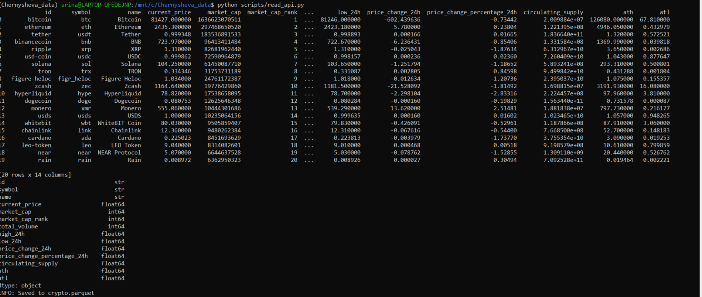

# scripts/

## read_api.py

Скрипт получает данные о криптовалютах из публичного API **CoinGecko** (https://www.coingecko.com/en/api).

**Что парсится:**
- Топ-20 криптовалют по рыночной капитализации
- Цена в USD (`current_price`)
- Рыночная капитализация (`market_cap`)
- Объём торгов за 24 часа (`total_volume`)
- Максимум/минимум за 24 часа (`high_24h`, `low_24h`)
- Изменение цены за 24 часа (`price_change_24h`, `price_change_percentage_24h`)
- Объём в обращении (`circulating_supply`)
- Исторический максимум/минимум (`ath`, `atl`)

**Результат:** pandas DataFrame с 20 строками и 14 столбцами.

### Скриншот выдачи



## Запуск

```bash
python scripts/read_api.py
```
